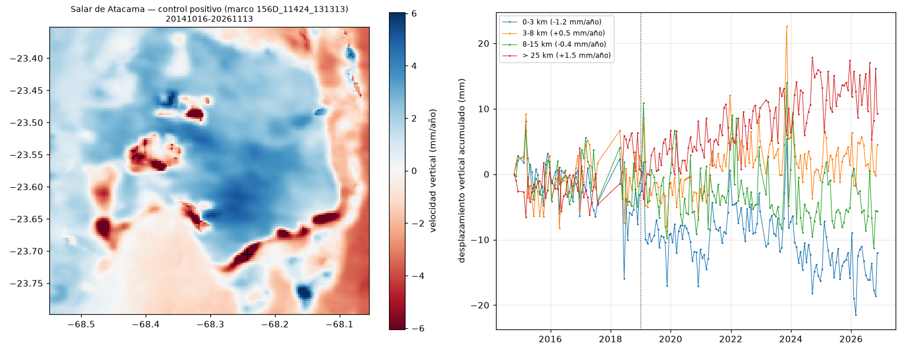
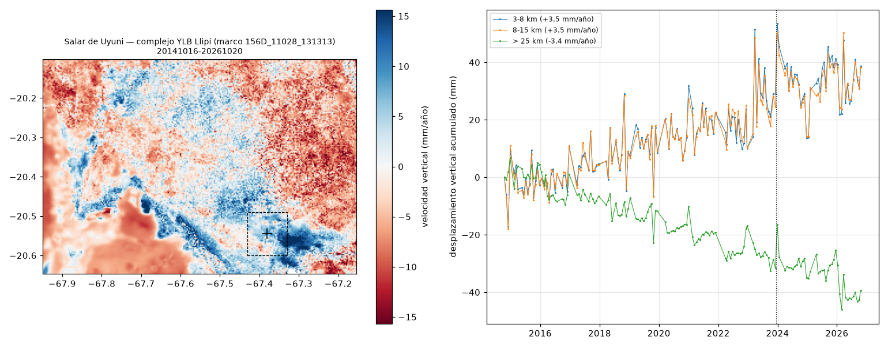

# 13 — Fase 4: InSAR propio sobre el Salar de Uyuni (control en Atacama) y el número global para Suramérica

Fecha de procesamiento: 2026-11-19. Resuelve el paso 1 de `12-fase3-factibilidad-metodologia-atacama.md` §6 (issue #21) y responde con una cifra la pregunta de fondo del repositorio: **¿la redistribución antrópica de masa en Suramérica altera la rotación terrestre de forma medible?**

Todo es reproducible con los scripts `scripts/fase4_*.py` (fuentes abiertas, sin registro). Los productos intermedios pesados quedan en `.cache/` (no versionado); los resúmenes, en `data/fase4_*.json`, y las figuras, en `docs/img/`.

## 1. Respuesta corta

| Pregunta | Número | Lectura |
|---|---|---|
| ¿Hay subsidencia alrededor de las pozas de YLB en Llipi (Uyuni)? | **+0.9 ± 0.9 mm/año** (0-8 km respecto a 10-20 km, desde el arranque industrial en dic-2023) | **No detectada**. Cota a 3σ: cualquier subsidencia local supera −1.6 mm/año. En Atacama, el mismo método detecta −5 a −13 mm/año. |
| ¿Cuánto mueve Uyuni el polo de rotación? | **0.39 µas/año** (cota superior: capacidad de diseño, 29 Mm³/año de salmuera) | 2.8×10⁻⁴ de la señal global de agua subterránea de Seo et al. (2023) |
| ¿Cuánto mueve el polo la suma de las fuentes antrópicas de Suramérica? | **1.08 µas/año = 0.033 mm/año** | **0.077 %** de la señal global de agua subterránea (4.36 cm/año). |
| ¿Y la duración del día (LOD)? | **−2.5 ns/año** (suma antrópica) | Harían falta unos 4 000 años de acumulación para llegar a la precisión diaria del IERS (~10 µs). |
| ¿Qué domina en el continente? | Amazonía (agua natural): **26 µas/año**, +0.17 µs/año | 24 veces la suma antrópica, y de signo contrario en LOD |

**Veredicto**: con datos propios y la física estándar de excitación, Suramérica **no** altera la rotación terrestre de forma medible por actividad humana directa. Su aporte antrópico es del orden de **una milésima** de la señal global de agua subterránea, que sí es detectable. Lo que el continente sí aporta de forma detectable a la rotación es su ciclo hidrológico natural (Amazonía), no la minería.

## 2. InSAR propio: método

| Paso | Detalle |
|---|---|
| Datos | Interferogramas desenrollados de COMET-LiCSAR. Uyuni: marco descendente `156D_11028_131313`; Atacama (control): `156D_11424_131313`. Ambos de oct-2014 a nov-2026. |
| Red reducida | Cadena de épocas separadas ~24 días (12-60 d) más todas las conexiones entre ellas de ≤ 72 días. Resultado: 295 interferogramas en Uyuni y 307 en Atacama, de unos 2 850 y 3 260 disponibles (`fase4_descarga_ventana.py`). |
| Recorte | Lectura parcial por rangos HTTP (GDAL `/vsicurl`). Uyuni: −67.95 a −67.15°, −20.65 a −20.10°; Atacama: −68.55 a −68.05°, −23.80 a −23.35°. |
| Inversión | NSBAS propio (`fase4_sbas.py`): multilook 3×3 (~300 m) y descarte de interferogramas con < 90 % de píxeles válidos (quedan 223 en Uyuni y 287 en Atacama). Restricción débil a un modelo lineal (γ = 10⁻⁴) para unir huecos de la red, como el de Sentinel-1B en 2022-2023. |
| Conversión | Velocidad LOS → vertical dividiendo por cos(incidencia) (33.8° y 33.5°), suponiendo movimiento solo vertical. Errores estándar corregidos por autocorrelación AR(1). |
| Métrica local | Mediana de 0-8 km alrededor de la operación (excluyendo las pozas) menos mediana del anillo de 10-20 km (`fase4_analisis.py`). Cancela las rampas atmosféricas y orbitales de gran escala. |

### 2.1 Corrección de ubicación respecto de la Fase 3

El mapa de coherencia media de LiCSAR muestra el complejo de pozas de YLB como una cuadrícula rectangular centrada en **−67.38°, −20.545°**. La coordenada que usó la Fase 3 (−67.70°, −20.40°) cae ~35 km al noroeste, cerca de la orilla del salar. Por eso la coherencia "en el sitio" reportada en `12-…md` §3.3 corresponde a otro punto y debe leerse como coherencia del salar, no de la operación.

### 2.2 Control positivo: Atacama

- Ruido espacial lejos de las fuentes: σ = 2.1 mm/año.
- El mapa muestra **parches localizados de subsidencia de −5 a −13 mm/año** (percentil 1 suavizado: −9.8 mm/año) en el núcleo y el borde sur del salar, donde están los campos de pozos y pozas. La magnitud coincide con la publicada (~1 cm/año; Delgado et al. 2024).
- No se verificó píxel a píxel que los parches coincidan con el cono publicado. Lo que el control establece es que **esta cadena (datos LiCSAR, red reducida y NSBAS) detecta señales de cm/año en un salar, con el signo correcto**.

### 2.3 Uyuni

| Métrica (vertical, mm/año) | Todo el periodo 2014-2026 | Antes de dic-2023 | Desde dic-2023 (planta industrial) |
|---|---|---|---|
| 0-8 km menos 10-20 km | **+2.29 ± 0.16** | +2.26 ± 0.21 | **+0.93 ± 0.85** |
| Umbral de detección 3σ | 0.47 | 0.62 | 2.55 |

Lectura:
1. **No hay cono de subsidencia alrededor de las pozas de Llipi.** La zona cercana se eleva levemente respecto del salar circundante durante todo el periodo. Desde el arranque industrial, el diferencial (+0.9 ± 0.9) no difiere del previo de forma significativa (−1.3 ± 0.9 mm/año de cambio, 1.5σ).
2. **Cota**: una subsidencia local mayor de **~1.6 mm/año** (≈ 0.93 − 3 × 0.85) desde dic-2023 se habría detectado. Es unas 6 veces menos que lo medido en Atacama.
3. Dentro y al este de las pozas hay una **elevación fuerte** (+10 a +15 mm/año). La interpretación más probable es la acumulación de sal precipitada en las piscinas (cambio de superficie, no de corteza); por eso las pozas se excluyen de todas las métricas.
4. El ruido de Uyuni (σ = 5.3 mm/año) es 2.5 veces el de Atacama. Una causa probable es la inundación estacional del salar, que decorrelaciona la señal: 72 de 295 interferogramas tenían menos del 90 % de píxeles válidos.

**Interpretación física** (hipótesis, no medida): sin subsidencia detectable, o la extracción real está muy por debajo de la capacidad de diseño (la prensa reportó operación al ~30 % en 2024), o la respuesta mecánica del acuífero de salmuera de Uyuni a la extracción es menor que en Atacama, o ambas. En todo caso, la masa usada abajo (29 Mm³/año) es una **cota superior**.

## 3. El número global: excitación de la rotación por todas las fuentes suramericanas

`fase4_excitacion_eop.py` reemplaza la aproximación de primer orden de `00-marco-teorico.md` §6 por las funciones de excitación de masa estándar (Barnes et al. 1983; Gross 2015). Estas incluyen el número de Love de carga (k'₂ = −0.301) y, para LOD, el desacople núcleo-manto (coeficientes 1.098 y 0.753). Además calcula el **movimiento del polo con longitud**, para sumar los casos como vectores. Como control, aplicada a la masa de Seo et al. (2023) (~126 Gt/año a latitudes medias), la fórmula da ~6 cm/año de deriva frente a los 4.36 cm/año publicados: el mismo orden de magnitud.

| Caso | Polo (µas/año) | LOD (ns/año) |
|---|---|---|
| Atacama (salmuera, 52 Mm³/año) | 0.79 | −0.40 |
| **Uyuni (salmuera, 29 Mm³/año, cota superior)** | **0.39** | **−0.28** |
| Vaca Muerta (hidrocarburos) | 0.53 | +0.06 |
| Maracaibo (petróleo, ilustrativo) | 0.32 | −0.61 |
| Sabana de Bogotá (cota alta) | 0.28 | −1.21 |
| Cerrejón | 0.04 | −0.07 |
| Glaciares de Colombia / Ecuador (cota alta) | 0.12 / 0.03 | −0.45 / −1.14 |
| **Suma antrópica directa (vectorial)** | **1.08** (0.033 mm/año, hacia 114°E) | **−2.5** |
| Suma antrópica + glaciares | 0.99 | −4.1 |
| Amazonía (agua natural, ganancia) | 26.0 | +174.8 |

Comparaciones:
- **Contra la señal global de agua subterránea** (Seo et al. 2023, 4.36 cm/año = 1.41 mas/año): la suma antrópica suramericana es el **0.077 %**, y Uyuni solo, el 0.028 %. Esta es la comparación físicamente justa: la de una señal ya detectada y atribuida.
- **Contra la precisión diaria del IERS** (polo ~30 µas, LOD ~10 µs; orden de magnitud de EOP 20 C04): la deriva antrópica tardaría ~28 años en acumular 30 µas. Eso **no** la hace detectable en 28 años: una deriva secular de ~1 µas/año tendría que separarse de una deriva natural de ~3-4 mas/año (ajuste isostático glaciar, hielo y océano), cuya incertidumbre es mucho mayor que 1 µas/año. La precisión diaria es un umbral generoso, no el real.
- **LOD**: −2.5 ns/año frente a ~10 µs de precisión, con variaciones naturales de milisegundos. Es indetectable con cualquier horizonte práctico.

### 3.1 Índice de detectabilidad rotacional (IDR)

Para que futuras fases comparen sitios con una sola cifra, se define **IDR₁₀ = señal acumulada en 10 años ÷ precisión diaria del IERS**. Un IDR < 1 garantiza que no hay detección; un IDR > 1 es necesario pero no suficiente.

| | IDR₁₀ polo | IDR₁₀ LOD |
|---|---|---|
| Uyuni | 0.13 | 2.8×10⁻⁴ |
| Suma antrópica de Suramérica | 0.36 | 2.5×10⁻³ |
| Amazonía (natural) | 8.7 | 0.17 |

## 4. Limitaciones

1. Una sola geometría (descendente) por sitio: no se separan los componentes vertical y este-oeste. Falta repetir con el marco ascendente `149A_11032_131313`.
2. Red reducida (~10 % de los interferogramas), sin corrección atmosférica (GACOS) ni de mareas sólidas. La métrica diferencial mitiga las rampas, pero no la atmósfera turbulenta local.
3. Multilook de ~300 m: un cono de menos de ~1 km alrededor de pozos individuales quedaría suavizado.
4. La coincidencia espacial del control de Atacama con el cono publicado no se verificó píxel a píxel.
5. Las masas de entrada de la §3 son las de los documentos de país: capacidades de diseño o cotas altas, no volúmenes medidos. Las funciones de excitación suponen redistribución uniforme sobre la esfera, sin función oceánica real ni autoatracción.
6. Las precisiones del IERS usadas son órdenes de magnitud, no valores tomados de un boletín concreto.
7. Desde la migración de 2025, los interferogramas de LiCSAR están repartidos entre CEDA y `LiCSAR_products.public` (JASMIN); el script resuelve cada enlace, pero el servidor entrega ~20 KB/s por conexión.

## 5. Próximos pasos

1. Marco ascendente `149A_11032_131313` en Uyuni, para la descomposición vertical/este-oeste y para confirmar la ausencia de subsidencia.
2. Comparar el control de Atacama con la geometría publicada (Delgado et al. 2024).
3. Aplicar la misma cadena al Cerrejón (issue #22, marco `004A_07905_191818`).
4. Buscar el volumen real de salmuera bombeado por YLB (memorias anuales) para pasar de cota superior a valor medido.
